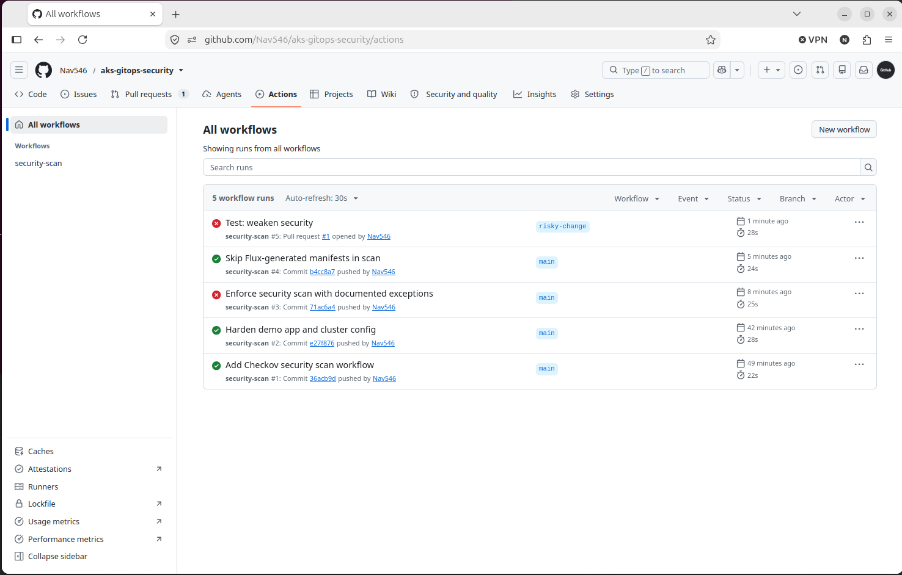
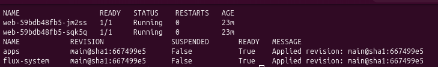

# AKS + Terraform + GitOps + Security Scanning

A small Azure Kubernetes Service (AKS) platform where **everything is code**:

- **Terraform** builds the cluster.
- **Flux (GitOps)** keeps the cluster matching this repo.
- **Checkov** scans every change in GitHub Actions and blocks risky ones.

If the cluster is destroyed, one command brings the whole thing back from Git.

## Architecture

```
GitHub repo ──► GitHub Actions (Checkov scan) ──► blocks risky changes
     │
     └──► Flux (inside AKS) pulls the repo every minute
                │
                └──► applies apps/demo (hardened nginx + NetworkPolicy)

Terraform ──► Azure resource group + AKS cluster (Azure CNI + network policy)
```

## Repo layout

| Path | What it is |
|---|---|
| `terraform/` | Resource group and AKS cluster |
| `apps/demo/` | Hardened nginx Deployment, Service and NetworkPolicy |
| `clusters/aks/` | Flux config (generated by `flux bootstrap`) and the `apps` Kustomization |
| `.github/workflows/security-scan.yml` | Checkov scan on every push and pull request |

## Prerequisites

- Azure subscription and the Azure CLI (`az login`)
- Terraform, kubectl, Flux CLI, GitHub CLI (`gh auth login`)
- Tested on Ubuntu 26.04

## Step by step

### 1. Build the cluster

```bash
export ARM_SUBSCRIPTION_ID=$(az account show --query id -o tsv)
cd terraform
terraform init
terraform plan
terraform apply
```

- `init` downloads the Azure provider.
- `plan` is a dry run showing what will be created.
- `apply` builds the resource group and AKS cluster (about 5 minutes).
- The subscription ID comes from an environment variable so it never reaches Git.

### 2. Connect kubectl

```bash
az aks get-credentials --resource-group aksgitops-rg --name aksgitops-aks --overwrite-existing
kubectl get nodes
```

`get-credentials` merges the cluster login into `~/.kube/config`. The node should show `Ready`.

### 3. Install Flux (GitOps)

```bash
export GITHUB_TOKEN=$(gh auth token)
flux bootstrap github --owner=<your-user> --repository=aks-gitops-security \
  --branch=main --path=clusters/aks --personal
```

Flux installs itself into the cluster, commits its config to `clusters/aks/`, and starts watching the repo. The `apps` Kustomization tells it to sync `apps/` every minute with `prune: true`, so files deleted from Git are deleted from the cluster.

### 4. See GitOps work

- Edit `replicas` in `apps/demo/deployment.yaml`, commit and push. The cluster follows.
- Scale it by hand with `kubectl scale deployment web -n demo --replicas=5`. After `flux reconcile kustomization apps --with-source`, Flux puts it back. Git is the source of truth.

Flux syncs on an interval. `flux reconcile` forces it immediately.

### 5. Security scanning

```bash
pipx install checkov
checkov -d terraform --compact --quiet
checkov -d apps --compact --quiet
```

Checkov reads the infrastructure code and compares it with hundreds of security rules. It never touches Azure.

**Results**

| | Kubernetes app checks failed |
|---|---|
| Before hardening | 19 (71 passed) |
| After hardening | 2 (88 passed) |

What was fixed in `apps/demo/deployment.yaml`: non-root user, no privilege escalation, read-only root filesystem, all Linux capabilities dropped, seccomp profile, CPU and memory requests and limits, readiness and liveness probes, no service account token, and a NetworkPolicy.

What was fixed in Terraform: Azure CNI with network policy enforcement, automatic patch upgrades, and a max pod count.

### 6. Pipeline enforcement

The GitHub Actions workflow runs Checkov on every push and pull request with `soft_fail: false`, so a new finding turns the check red. A test pull request that set `allowPrivilegeEscalation: true` was blocked by check `CKV_K8S_20`.

Flux's own generated manifests (`clusters/aks/flux-system`) are excluded, because they are third-party code.

### 7. Disaster recovery

The cluster was destroyed and rebuilt (the network type change forces replacement). After re-running `flux bootstrap`, both hardened pods and the NetworkPolicy were back about 40 seconds later with no manual `kubectl apply`.

## Accepted findings

These checks are skipped on purpose in the workflow, with reasons.

| Check | Why accepted |
|---|---|
| CKV_AZURE_170 (paid SKU), CKV_AZURE_4 (Azure Monitor) | Cost for a demo |
| CKV_AZURE_115 (private cluster), CKV_AZURE_6 (authorized IP ranges) | Would lock out a home IP that changes |
| CKV_AZURE_117, 227, 226 (disk encryption set, ephemeral disks) | Need Key Vault or a larger VM size |
| CKV_AZURE_141, 116 (local admin disabled, Azure Policy) | Need Entra ID integration; complexity trade-off |
| CKV_AZURE_172, 232 (secrets rotation, system pool taints) | Not relevant to this demo |
| CKV_K8S_43 (image digest), CKV_K8S_40 (high UID) | nginx-unprivileged runs as UID 101; pinning a digest is a next step |

## Cost control

AKS bills while it runs. Always clean up:

```bash
cd terraform
terraform destroy
```

## Possible next steps

- Pin the image by digest and run as a high UID
- Add Trivy image scanning to the pipeline
- Enable Microsoft Defender for Cloud
- Private cluster with a jump host

## Screenshots

**Pipeline: green runs, and the red runs that caught problems (run #5 blocked a risky change)**



**Cluster running from Git: two hardened pods, Flux Kustomizations Ready**


